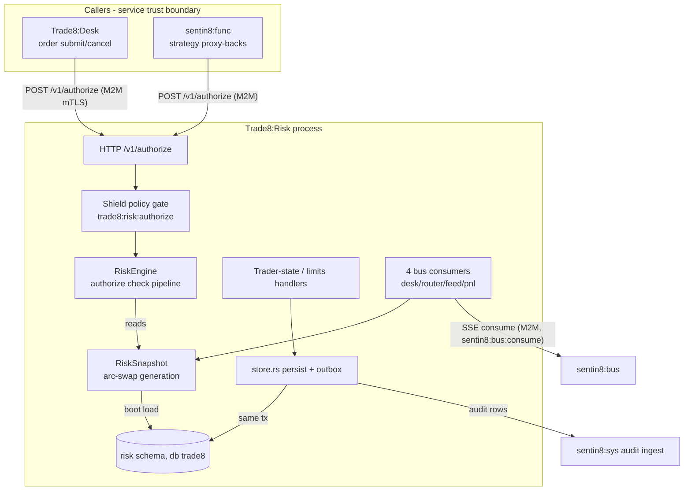

# Trade8:Risk - Pre-Trade Authorization Service

> Audience: anyone evaluating or onboarding to the service. For the
> wire-level construction read `DESIGN.md`; for business functionality read
> `BUSINESS.md`. Vertical context: the top-level `DESIGN.md`

> (system map) and `BUSINESS.md` (business view).

## 1. Summary

Trade8:Risk is the synchronous, in-env pre-trade authorization gate. Desk
calls it over a direct TLS path before accepting any order mutation; it
evaluates trader state, buying power (reserved-notional accounting), share/
position/open-order limits, symbol/destination/market restrictions, market
periods, order-class allowlists, short-locate exemptions, and the uptick
rule - returning a single `authorize` verdict with an itemized check trace.
The hot path never touches the database: every check reads `arc-swap`
snapshot caches fed at boot and kept live by bus consumers.

## 2. Motivation

Pre-trade gating has three properties that shape this design:

- **Latency is the product.** The gate sits on the order-acceptance critical
  path; a per-request DB round trip would dominate the budget. All decision
  inputs therefore live in memory as immutable snapshot generations.
- **Determinism and auditability.** A deny must explain itself: every check
  appends an itemized result (limit, reserved, order notional, pass/fail) to
  the verdict, which Desk journals on rejection - supervisors and support
  desks can replay exactly why an order was refused.
- **Separation of *decision* and *administration*.** Who may invoke the gate
  (Shield policy step, live role grants) is separate from the gate's µs-class
  math. Trading-state controls (closing-only, disable) are Risk-owned runtime
  data - never identity mutations - so a supervisor can lock a trader down
  immediately without touching Sentin8:Auth.

Before the platform, these lived in the order-daemon's in-process limit
objects with bespoke reload choreography - no shared tenancy, no auditable
deny trace, no event-driven freshness. Risk re-implements them as one
stateless gate on the Sentin8 planes.

## 3. Architecture & High-Level Design

The verdict path is pure: verify → Shield allow → `engine.authorize(&req)`
over the current snapshot → return. Persist mutations write the DB + an
outbox event first, then swap the snapshot so every consumer/admin surface
observes the same generation discipline.

## 4. Key Traits and Data Structures

- **`RiskState`** - shell core + the shared `RiskEngine`.
- **`RiskEngine`** (`core.rs`) - `publish(snapshot)` / `current()` / the
  `authorize(&AuthorizeRequest)` pipeline over `ArcSwap`.
- **`RiskSnapshot`** - one immutable decision context: limits (six kinds,
  `LimitRow` with specificity binding user > office > env), trader states,
  blocked/allowed symbol sets, blocked destinations/markets, cancel-denial
  keys, per-destination order-type/TIF allowlists, halt/short-exempt sets,
  uptick rule per market, last/prior print mirror, open-order counts and
  reserved notional per trader.
- **`ReservationJournal`** (`consumers.rs`) - the journaled buying-power
  accounting: order id → reserved notional, (user, symbol) → position
  counters, symbol → last/prior print. Shared across consumer tasks behind a
  mutex; idempotent by order id so at-least-once redelivery converges.
- **Contracts** - `trade8::contracts::risk::AuthorizeRequest`,
  `AuthorizeVerdict`, `CheckResult`, `CheckKind`, `LimitRow`, plus the
  `TraderState` wire vocabulary.

## 5. Rationale, Trade-offs, and Alternatives

- **Snapshot-per-generation (`arc-swap`) instead of per-check locks.**
  Readers (authorize) never block writers (consumers/admin); the swap is
  atomic and readers see a consistent, complete generation. Rejected: a
  lock per check (hot-path contention), per-request DB lookups (latency).
- **One batch authorize call, not N check calls.** Desk sends the full
  order + context once and gets one verdict with the itemized trace; checks
  sequence over a single snapshot read. Rejected: per-check RPCs (N ×
  latency, inconsistent snapshots across checks).
- **Event-fed mirrors instead of synchronous reads.** Open orders, fills and
  prints are consumed from the desk/router/feed/pnl families; the authorize
  path never calls other services. Rejected: on-the-fly reads (latency +
  cross-service coupling on the hot path).
- **M2M-only authorize endpoint.** The gate is for services (Desk/Func);
  BFF never proxies it. This keeps leaked user tokens out of the risk path.
- **Mimalloc allocator** (master design §11): tail-latency on the µs gate.

## 6. Internal Implementation & Invariants (Private Design)

**Invariants** (unit-tested in `core.rs`, `tests/policy.rs`, `tests/sql_matrix.rs`):

- An authorize request evaluates against exactly ONE snapshot generation
  (`current()` taken once); no partial upgrades mid-request.
- Every check appends a `CheckResult` to the trace before any deny; the
  verdict carries the trace on allow as well (Desk persists it on deny).
- `reserved_notional` accounting is idempotent per order id: a redelivered
  `order:accepted` is a no-op; terminal desk events release exactly once.
- Closing-only traders pass `can_close` and fail `can_open`; disabled states
  fail both. The default state for an unknown trader is *active* - an
  explicit disable row exists for every restricted trader.
- Limit specificity: user > office > env; disabled rows never bind;
  `override_value` wins over `value` (`LimitRow::effective`).
- Uptick: `up` requires last > prior; `updown` requires last ≥ prior;
  `down` and print-less symbols never block; request-carried prints
  (Desk's fresher view) override the mirror.
- Snapshot publishes are whole-generation: admin writes persist + emit an
  outbox event, then swap; consumers clone-modify-swap the same way - no
  in-place mutation, no lost updates.
- Persist writes run on a tx obtained via `begin()` after
  `set_tenant_context` (transaction-local RLS context, same connection).

## 7. Unresolved Questions / Future Designs

- **Ladder ownership** - the risk-level ladder (`risk.level`, `risk.action`,
  `risk.level_action`) evaluates today from Pnl's summary event payload when
  it carries the ladder configuration; whether the ladder should instead be
  pushed into the snapshot at boot from the DB tables is an open design
  point.
- **Per-currency buying power** - limits carry an asset-class/currency split
  in the schema; the snapshot arithmetic is single-pool today.
- **Step-up auth on trader-state writes** - the route is permission-gated
  now; binding the platform's step-up (recent interaction / PIN re-entry)
  for high-impact supervisor actions is a platform-level design item.
- **`trade8:risk:restriction:updated`** - the event constant exists but
  restriction mutations do not publish it yet (snapshot swaps are local);
  whether remote consumers need invalidation events is open.

---

**Design attribution:** trade8:risk and its underlying concepts were designed by Hamid Jahanzad <Hamid@Jahanzad.com>.
